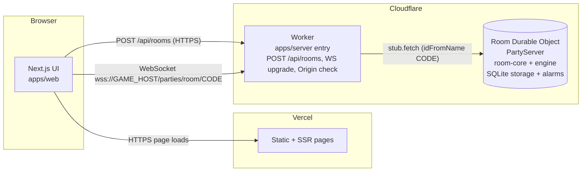
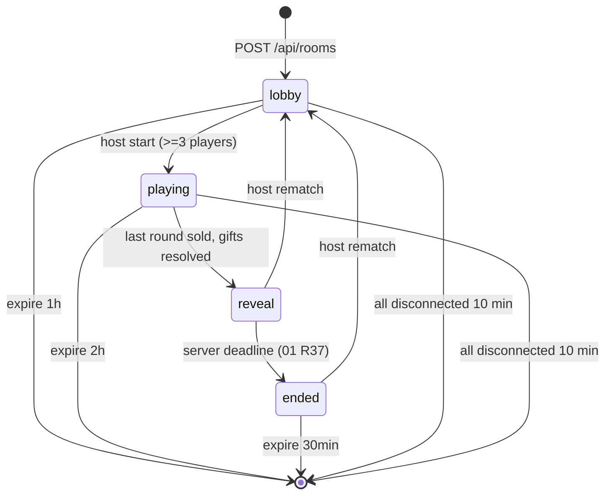

# 05 - Tech Stack, Architecture, Protocol, Room Server

Status: planning doc (no code exists yet). Verified facts dated 2026-10-10/11; see `research/tech-decisions.md` for sources.
Related: `01-game-rules.md` (rules R1..), `02-modes-and-scaling.md`, `03-content.md`, `04-ux-and-ui.md`, `06-workstreams.md`.

Blocks labelled **SPEC** are design specifications in TypeScript-like notation. They are NOT code to paste; WS0 turns them into `packages/protocol` types and zod schemas. If a SPEC here conflicts with the code in `packages/protocol`, the code wins after WS0 merges and this doc must be updated in the same PR (see contract-change process in `06-workstreams.md`).

---

## 1. Decision (one paragraph)

Next.js on Vercel serves the UI. Each game room is one Cloudflare Durable Object (DO) written with the open-source PartyServer library and deployed with Wrangler. Browsers load the page from Vercel, then open a WebSocket straight to the Cloudflare Worker, which routes to the room's DO. Rules live in pure TypeScript packages that run unchanged in tests, in the DO, and in bots. The server is authoritative for everything: timers, legality, hidden values.

## 2. What each piece does (plain English)

| Piece | What it does for us |
|---|---|
| **Next.js** | React framework for the website (landing, join, lobby, game screens). Familiar to the owner. Pure client-rendered game pages are fine. |
| **Vercel** | Hosts the Next.js site for free (Hobby plan, non-commercial use only), deploys from git, gives preview URLs per PR. Does NOT host the game rooms. |
| **Cloudflare Worker** | Tiny stateless HTTP entry point on Cloudflare. Handles `POST /api/rooms`, checks `Origin`, and forwards WebSocket upgrades to the right room. |
| **Durable Object (DO)** | A stateful, single-threaded "room computer". One per room code. Holds the game state, all player sockets, and its own timers (alarms). Sleeps (hibernates) when idle. Messages are handled one at a time, so no race conditions. |
| **PartyServer** | Open-source library (from the PartyKit authors) that wraps a DO with `onStart/onConnect/onMessage/onClose/onError/onAlarm` hooks (never override `alarm()` or `webSocket*` yourself) and opt-in WebSocket hibernation (`static options = { hibernate: true }`). Verified against partyserver 0.5.10 (2026-10-11). We use the library, NOT hosted PartyKit (hosted PartyKit shuts down 23 Oct 2026). |
| **Wrangler** | Cloudflare's CLI. `wrangler dev` runs the Worker + DO locally, `wrangler deploy` publishes, `wrangler tail` streams logs. Works natively on Windows. |
| **pnpm monorepo** | One repo, several packages (`apps/*`, `packages/*`) sharing TypeScript types. pnpm workspaces link them. Lets many agents work in separate folders. |
| **zod** | Runtime validation of every incoming message and of content data. |
| **vitest + @cloudflare/vitest-plugin** | Test runner. Requires vitest 4.1 or later and plugin 1.x, the successor to the deprecated `@cloudflare/vitest-pool-workers`. Tests run inside a real local workerd, so DO storage, alarms and hibernatable WebSockets behave authentically. Configure it with `cloudflareTest({ wrangler: { configPath: "./wrangler.jsonc" } })` from `@cloudflare/vitest-plugin`, inside vitest's `defineConfig`. Import `env` and `exports` from `cloudflare:workers` (use `exports.default.fetch`, since `SELF` is deprecated). Import `runDurableObjectAlarm`, `runInDurableObject`, `evictDurableObject` and `listDurableObjectIds` from `cloudflare:test`. Verified on Windows on 2026-10-11. |
| **Playwright** | Browser end-to-end smoke test. |

### Why not Vercel-only
Vercel WebSockets are beta; Hobby functions max out at 300s duration, so sockets are cut at ~5 min. Reconnects may hit a different instance, so in-memory room state would be lost. Rooms last 20-40 min and need server-owned timers. Rejected.

### Fallback (if Cloudflare proves unworkable)
A Node server running Colyseus (has `allowReconnection`) on Fly.io (about $2.19/mo, no free tier) or Railway Hobby ($5/mo). The pure packages (`engine`, `room-core`, `protocol`) are reused; only `apps/server` is rewritten. Render free tier sleeps after 15 min idle and can restart: unsuitable. Optional later: move the frontend to Cloudflare via OpenNext (supports Next 14-16; on Windows requires WSL).

## 3. Architecture



ASCII equivalent:

```
 Browser ---HTTPS pages---> Vercel (Next.js, static/UI only)
    |
    +---POST /api/rooms----> Cloudflare Worker --creates--> Room DO (name = CODE)
    +---WebSocket wss------> Cloudflare Worker --forwards-> Room DO
                                                              |- RoomState in memory
                                                              |- SQLite: state blob, events log
                                                              |- Alarm: earliest deadline
```

The browser never talks to Vercel for game traffic. Vercel never talks to Cloudflare.

## 4. Monorepo layout and dependency rules

```
/
  package.json, pnpm-workspace.yaml, tsconfig.base.json, eslint config, .github/workflows/
  README.md                         (pinned versions recorded here, see section 15)
  docs/                             (this folder)
  apps/
    web/                            Next.js UI
    server/                         Worker + Room DO shell (PartyServer, wrangler.jsonc)
  packages/
    protocol/                       wire types + zod schemas, error codes, Category/ids
    content/                        item data; two entry points: full and public
    engine/                         rules, seeded RNG, bots, config.ts constants
    room-core/                      pure reducer + view (redaction) + lifecycle
  tools/
    mock-server/                    fake room server for frontend dev (WS0)
    smoke/                          deploy smoke script (WS7)
    sim/                            balance simulator (WS1)
```

### Dependency rules (decided)

| Package | May import | Must NOT import |
|---|---|---|
| `protocol` | `zod` only | any workspace package |
| `content` | `protocol` (types: `Category`, `ItemId`), `zod` | engine, room-core, apps |
| `engine` | `protocol`, `content` (full entry) | room-core, apps, any I/O, `Date.now`, `Math.random` |
| `room-core` | `protocol`, `engine` | apps, `content` directly (go through engine), Cloudflare/PartyServer APIs, `Date.now` |
| `apps/server` | `room-core`, `protocol`, `partyserver`, `wrangler` types | `engine` internals directly, `apps/web` |
| `apps/web` | `protocol`, `content/public` (public entry only) | `engine`, `room-core`, `content` full entry, `apps/server` |
| `tools/*` | anything (dev only; never imported by apps) | - |

Justification:
- **protocol has no workspace deps** so it can be imported anywhere (including the frontend) without dragging rules or hidden data along. Shared vocabulary (Category list, id brands, bid-card kinds) lives here.
- **content is split into two entry points.** `@dbay/content` (full) includes each item's hidden actual value; `@dbay/content/public` is a projection with id, name, category, icon, estimated value only, plus the specials' public fields (name, `estimatedDisplay`, `fixedValue`). The web app may import only `/public`. This keeps real values out of the browser bundle: a view-layer leak test (room-core) plus a CI step grepping the built web bundle for the secret-field names back this up.
- **engine depends on content (full)** because scoring needs actual values. **room-core reaches content only via engine**, keeping one place that builds decks.
- **web depends on protocol + content/public** for rendering item names/icons from ids in a snapshot. It never imports engine/room-core, so it cannot compute or see hidden state. Enforced by ESLint `no-restricted-imports` and `eslint-plugin-boundaries`-style rules configured in WS0; also tsconfig path restrictions.
- **Time/randomness purity:** only the DO wrapper in `apps/server` calls `Date.now()`/`crypto`. Lint rule `no-restricted-globals`/`no-restricted-properties` bans `Date.now`, `new Date()`, `Math.random` in `engine`, `room-core`, `content`.
- Package names are scoped `@dbay/<name>` (rename at WS0 if desired; update this doc).

## 5. Identity, room codes, join flow

- **Room code:** 5 characters from a 30-character alphabet `23456789ABCDEFGHJKMNPQRSTVWXYZ` (digits 2-9 plus letters except I, L, O, U). Generated with `crypto.getRandomValues` using rejection sampling (no modulo bias). 30^5 = 24.3M codes. (The approved plan said "28-character"; the exclusion list it gives yields 30. See section 18.)
- `POST /api/rooms` on the Worker creates the room and returns `{code}`; retries on collision. Joining NEVER creates a room: unknown code -> HTTP 404 / error `ROOM_NOT_FOUND`.
- Input normalisation: uppercase, strip whitespace and hyphens. Rooms live at `/r/ABCDE`. DO is addressed by `idFromName(code)`.
- Join attempts rate-limited (code is the only access control).
- **Identity:** on first `join`, the server issues `playerId` plus a random 128-bit `secret`; stores only `SHA-256(secret)`. The client stores `{playerId, secret}` in `localStorage` keyed by room code and sends it in `hello` (never in the URL). A valid `hello` reclaims the seat and closes the previous socket for that seat.
- Usernames 1-16 chars (trimmed, no control chars); duplicate gets suffix ` 2`, ` 3`. Max 6 players. Min to start 3 seats (humans + bots, at least 1 human = the host; see 01/02).
- Kicked players are banned from that room (store hash of their secret + no new join from same `playerId`; accept that a new anonymous join is possible - documented limitation).

## 6. Protocol spec

Transport: one WebSocket per client, JSON text frames, max 2048 bytes inbound. Full snapshots, no deltas (snapshot < 5KB, <= 6 clients). `PROTOCOL_VERSION` integer in `protocol`; mismatch -> error `VERSION_MISMATCH`.

All messages have discriminant field `t`.

### 6.1 Client -> server (SPEC)

```
// SPEC (not code)
ClientMsg =
  | { t:"join";  v:number; name:string }                       // new seat. Allowed only before first hello on this socket.
  | { t:"hello"; v:number; playerId:string; secret:string; lastRev?:number } // reclaim seat. lastRev is advisory (always get a full snapshot).
  | { t:"ping";  c:number }                                    // clock sync probe; c = client monotonic ms, echoed
  | { t:"snap" }                                               // request full snapshot (tab refocus)
  | { t:"leave" }                                              // voluntary leave; frees seat in lobby, auto-passes in game

  // Game actions - all carry clientSeq (monotonic per client, >=1)
  | { t:"bid";   seq:number; card:CardId; bay:number }         // play a bid card on bay index
  | { t:"pass";  seq:number }                                  // Classic: decline my call (otherwise timer expiry auto-passes)
  | { t:"gift";  seq:number; target:string }                   // end-of-game: holder of Gift picks victim playerId
  | { t:"giftGive"; seq:number; item:string }                  // end-of-game: victim picks a scorable card (ItemId or Display Case id) to hand over
  | { t:"rename"; seq:number; name:string }                    // lobby only; same rules as join names

  // Host-only (rejected with NOT_HOST otherwise)
  | { t:"start";   seq:number }                                // uses the lobby opts; needs >= 3 seats
  | { t:"setOpts"; seq:number; mode?:"classic"|"frenzy"; relaxed?:boolean; bidWindowMs?:3000|5000|8000 }
  | { t:"addBot";  seq:number }
  | { t:"rmBot";   seq:number; playerId:string }
  | { t:"kick";    seq:number; playerId:string }
  | { t:"rematch"; seq:number }
```

Notes: either mode is allowed at any player count (default Classic for 3-4, Frenzy for 5-6; see 02). `rematch` is accepted in phases `reveal` and `ended`. Exact card and special-card actions follow `01-game-rules.md`; add message types through the contract-change process, never ad hoc.

### 6.2 Server -> client (SPEC)

```
// SPEC (not code)
ServerMsg =
  | { t:"welcome"; v:number; playerId:string; secret?:string; code:string }  // secret present only in reply to "join"
  | { t:"snap";    rev:number; now:number; view:PlayerView }                  // the ONLY carrier of game state
  | { t:"ack";     seq:number; ok:true }
  | { t:"ack";     seq:number; ok:false; code:ErrorCode; msg?:string }
  | { t:"pong";    c:number; now:number }                                     // c echoed; now = server epoch ms
  | { t:"kicked" }
  | { t:"closing"; reason:"expired"|"ended"|"deploy"|"banned" }
  | { t:"err";     code:ErrorCode; msg?:string }                              // connection-level (not tied to a seq)
```

### 6.3 PlayerView (SPEC)

```
// SPEC (not code). Built ONLY by room-core view(state, playerId). Everything the screens in 04 show must be derivable from it
// plus @dbay/content/public (names, categories, est values, special display) keyed by id.
PlayerView = {
  code: string
  phase: "lobby" | "playing" | "reveal" | "ended"
  stage?: "bidding" | "gifts"          // only while phase = "playing" (engine phases; 01 section 6)
  opts: { mode:"classic"|"frenzy"; relaxed:boolean; bidWindowMs:number }   // Relaxed x1.5 is applied server-side to deadlines
  me: PlayerId
  hostId: PlayerId
  myHand: Array<{ id:CardId; kind:"value"|"proxy"; value?:number /* absent for proxy */; onBay?:number /* bay idx if currently committed */ }>
  canAct: boolean                      // Classic: it is my call and the window is open. Frenzy: not in cooldown and phase allows bids.
  cooldownUntil?: number               // Frenzy only, epoch ms server time (bidCooldownMs after my last accepted bid)
  players: Array<{ id:PlayerId; name:string; color:string; shape:string; connected:boolean; isBot:boolean;
                   cardsInHand:number;            // others: COUNT only. Never which cards.
                   collection: string[];          // won ItemIds and Display Case ids (public; est values come from content/public)
                   gifts: number }>               // Gifts held and not yet resolved (public)
  bays: Array<{ idx:number;
                card: string | null;              // ItemId or special id; null = empty (deck ran out)
                stack: Array<{ by:PlayerId; card:CardId; kind:"value"|"proxy"; value?:number }>  // oldest first; ALL public and face-up (01 R16); Proxy has no value
                topBid: null | { by:PlayerId; kind:"value"|"proxy"; value?:number }              // computed per 01 R15
                endsAt?: number }>                // epoch ms server time; Frenzy per-bay timer only. Client shows "+3s" when it increases between snapshots.
  turn?: { player:PlayerId; color:string; endsAt?:number; phase:"window"|"gap" }   // Classic: current call. endsAt absent during gaps/skips.
  round: { n:number; of:number; halfway:boolean; last:boolean }                    // 01 R7/R9, 02 F7
  deckLeft: number
  log: Array<{ n:number; kind:EventKind; by?:PlayerId; card?:string; bay?:number; amount?:number|"proxy"; extra?:string }>  // last 30, structured; text lives in 04 section 4.5
  gift?: { stage:"pickTarget"|"pickItem"; holder:PlayerId; victim?:PlayerId; endsAt:number; remaining:number }   // present when stage = "gifts"
  reveal?: { players: Array<{ id; items: Array<{ card:string; est:number; actual:number; tag:"steal"|"ripped"|null }>;
                              displayCaseAssign: Array<{ card:string; category:string|null }>; collections: string[] /* doubled categories */;
                              total:number; rank:number; tiebreak?:number }>;
             giftLog: Array<{ holder; victim; card:string|null }> }                // ONLY when phase = "reveal" | "ended"
}
```

`EventKind` = one value per row of the `04-ux-and-ui.md` section 4.5 event table (e.g. `gameStart`, `turn`, `pass`, `autoPass`, `bid`, `outbid`, `lead`, `rejected`, `extended`, `sold`, `unsold`, `refill`, `collection`, `special`, `halfway`, `lastRound`, `gameOver`, `left`, `rejoined`, `host`); WS0 fixes the exact union in `protocol`.

Hidden-info rule of thumb: a field may appear in a view only if it is derivable from what that player legitimately sees at the table. Table-visible: every card on a bay (including Proxies, face-up), all won items, hand counts. Hidden: other hands, deck order, seed, `actualValue`/`tier` before `reveal`. The leak test encodes exactly this list.

### 6.4 Error codes (SPEC)

`BAD_MESSAGE` (schema/size), `VERSION_MISMATCH`, `ROOM_NOT_FOUND`, `ROOM_FULL`, `ROOM_EXPIRED`, `GAME_IN_PROGRESS` (join after start), `BAD_SECRET`, `BANNED`, `NAME_INVALID`, `NOT_HOST`, `NOT_YOUR_TURN`, `NOT_ENOUGH_PLAYERS`, `WRONG_PHASE`, `ILLEGAL_BID` (01 R16 failures: does not beat top bid, own top, card not in hand, invalid bay), `TOO_LATE` (server time at/after deadline; 02 F4), `COOLDOWN` (Frenzy bid cooldown; 02 F5), `BAD_OPTS` (invalid setOpts), `RATE_LIMITED`, `INTERNAL`.

HTTP: `POST /api/rooms` -> `201 {code}` | `403` bad origin | `429` rate limited. Unknown room WS upgrade -> `404`.

### 6.5 Ack semantics, rev, ordering

- Every action (anything with `seq`) gets exactly one `ack` (ok or error), sent BEFORE the broadcast snapshot of the resulting state.
- `seq` is per-client, monotonic. The server remembers the highest seq processed per player and replies `ok:true` idempotently (no re-apply) to a duplicate/older seq - protects against retries after reconnect.
- `rev` is a per-room integer incremented on every state change that alters any view. Client ignores any `snap` with `rev <= current`. After reconnect, the first snapshot is always accepted (client resets its rev on `welcome`).
- Optimistic UI is allowed (e.g. highlight selected card, shake on error), but the snapshot is truth; the client never mutates game state locally.
- Rejections do not bump `rev` and are not logged as game events.

### 6.6 Clock sync and keepalive

- App-level `ping{c}` / `pong{c, now}` for clock offset: on connect send 8 pings 200ms apart, then every 30s. For each sample: `rtt = recvTime - c`; `offset = now + rtt/2 - recvTime`. Offset estimate = median of offsets of the 5 lowest-RTT samples. Countdown rendering uses `serverNow ≈ Date.now() + offset` and `endsAt`.
- Snapshots also carry `now` (serverNow) so a single snapshot is enough to roughly correct drift.
- Transport keepalive: use the native `this.ctx.setWebSocketAutoResponse(new WebSocketRequestResponsePair("ping","pong"))`, called in `onStart`. PartyServer has no wrapper for it. The DO answers without waking up and isn't billed for the time (each string is at most 2,048 characters). The client pings every 15s; a seat is marked disconnected after 30s with no traffic.
- Client (partysocket 1.3.0):
  - Set `maxEnqueuedMessages: 0`. The default is Infinity, which buffers actions while disconnected and replays stale bids after reconnecting.
  - Send `hello` in the `open` listener, which fires on every reconnect.
  - Pass `minReconnectionDelay: 500` and `maxReconnectionDelay: 5000`. The defaults are 3s–10s, too slow for rejoining.
- Bids are judged against server time only; client clocks are never trusted.

## 7. Room state, loop, effects

```
// SPEC
RoomState = { meta:{code, schemaVersion, createdAt, expireAt, hostId, seed?, banned:[hash]},
              players: [...incl. secretHash, connected, lastSeen, lastSeq],
              game: EngineState | null,
              deadlines: Array<{ at:number; kind:string; data? }>  // sorted ascending
              rev:number }
Event  = join | leave | action | tick | host | connect | disconnect
Effect = send(playerId|all, ServerMsg) | setAlarm(at) | persist | closeSocket(playerId, why) | log(entry)
reduce(state, event, now) -> { state, effects }      // pure, in room-core
view(state, playerId) -> PlayerView                  // pure, in room-core; the ONLY state->client path
```

- Types in `protocol`; `reduce`/`view` in `room-core`; the authoritative copy lives in DO memory.
- After each accepted event the wrapper saves `state:v{schemaVersion}` (one blob) to DO SQLite-backed storage and appends to an `events` table (seed + events) for replays/golden tests. Unknown `schemaVersion` on wake (after a redeploy): room ends (`closing: deploy`), no migrations.
- **Wrapper order is fixed:** reduce -> persist -> setAlarm -> send. Persist before send so no client ever sees state that would be lost.
- Wrapper is the only caller of `Date.now()`.
- The DO handles one message at a time; wrap wake-up load in `blockConcurrencyWhile`.
- Never log hidden values during a game; log only `{room, event, rev}` JSON.

## 8. Room lifecycle



(`reveal` is a server phase where values are exposed; the reveal animation is client-side only. ASSUMED trigger: `reveal` -> `ended` by deadline, see 01 R37. Gift resolution happens inside `playing` with `stage: gifts`.)

- **Expiry:** alarm at `meta.expireAt`: lobby 1h, game 2h, post-game 30 min from entry to that phase. If every connection drops, set `expireAt = min(expireAt, now + 10 min)`; on expiry call `storage.deleteAll()` and close sockets. Reconnect within 10 min cancels the shortened deadline (recompute).
- **Host migration:** if host disconnected > 30s, host passes to the longest-connected connected human. Host-only actions: start, setOpts, addBot, rmBot, kick, rematch. Bots are never host.
- **Auto-pass** applies only to players currently disconnected (or timer-expired turns); connected-but-slow players just lose the turn at the timer.
- **Rematch** (host; phases `reveal`/`ended`) returns to lobby keeping seats, clears game, new seed. Bots keep their seats.
- **Bot seats** (`addBot`/`rmBot`, lobby only): room-core asks the `engine` bot policy for bot actions on `tick`, after a small human-like delay (`botDelayMs`, default 800-2000 seeded). Bots use only public info and never count as connected humans for expiry or host migration.

## 9. Timers and alarms

- Never `setTimeout` for game logic (hibernation wipes memory). DO alarms only, one alarm per DO.
- All deadlines are data in `state.deadlines[]` (turn end, bay close, Frenzy extension, expiry, host-migration check, disconnect cutoff). After every event the wrapper sets the alarm to the earliest `at`. On `onAlarm`, wrapper calls `reduce(state, {type:"tick"}, now)`, which fires every deadline `<= now`.
- Snapshots carry `endsAt` and `now`; the client animates countdowns from the offset-corrected clock.
- **Anti-snipe (Frenzy):** exact rule in `02-modes-and-scaling.md` F2 (every accepted bid sets `closesAt = max(closesAt, now + antiSnipeMs)`, hard cap), computed from server time inside the reducer. Relaxed timing multiplies durations x1.5 at deadline creation.
- Bids are validated against `now` passed by the wrapper; `TOO_LATE` if `now >= endsAt`.

## 10. Redaction rules

- `view(state, playerId)` is the only path from game state to any connection. Nothing else may call `send` with game data.
- Own hand: full. Others: counts only. Never sent before reveal: seed, deck order, undealt items' actual values, other players' hands, actual values of items (only estimates until `reveal`).
- Leak test (MUST): for every phase x every player, serialize the view and assert it contains none of the forbidden strings/values (seed, other hands' card ids, actual values) and that `JSON.stringify(view)` is unchanged by mutating other players' hidden data.
- Web bundle check: CI greps the built bundle for the `actual` field name of items.

## 11. Reconnect sequence

```mermaid
sequenceDiagram
  participant C as Client
  participant W as Worker
  participant R as Room DO
  C->>W: WS upgrade (Origin checked)
  W->>R: forward
  C->>R: hello{v, playerId, secret, lastRev}
  R->>R: verify SHA-256(secret); close old socket for seat
  R-->>C: welcome{playerId, code}
  R-->>C: snap{rev, now, view}
  R-->>C: (other clients get snap: connected=true)
  Note over C: client discards its rev, adopts snap; sends ping burst
```

Client backoff 500ms, doubling to 5s cap, with jitter. On `visibilitychange` -> visible: if socket not open, reconnect; else send `snap`. Wake Lock requested during `playing`. First-time join: `join{name}` -> `welcome{secret}` -> `snap`. Bad secret -> `err BAD_SECRET`, client clears stored secret and offers to join anew (only allowed in lobby).

## 12. Persistence, rate limits, security

- **Persistence:** DO SQLite-backed storage only (free plan requirement). Keys: `state:v{N}`; table `events(n, at, json)`; seed inside state. All deleted with `deleteAll()` on expiry.
- **Rate limits:** 20 msg/s per connection (excess -> `RATE_LIMITED`, 3 strikes -> close); message cap 2KB; 10 room creations/hour/IP (use `CF-Connecting-IP`, counted in a separate small "limiter" DO or Workers rate limiting binding - decide in WS3b); join attempts per IP per minute limited similarly.
- **Origin:** Worker rejects requests whose `Origin` is not in `ALLOWED_ORIGINS` (comma-separated, exact match) on `POST /api/rooms` AND on WS upgrade. CORS headers only for allowed origins. Origin is a browser-enforced header and is not authentication; the room code and seat secret are the access control.
- Input: zod-parse every frame; unknown `t` -> `BAD_MESSAGE`; names sanitised and rendered as text only.
- Secrets compared as hashes with constant-time compare.

## 13. Environment variables

| Name | Where | Required | Example | Purpose |
|---|---|---|---|---|
| `NEXT_PUBLIC_GAME_HOST` | apps/web (Vercel env, `.env.local`) | yes | `localhost:8787` / `auction-server.<acct>.workers.dev` | Host (no scheme) for HTTP + WS to the Worker; scheme derived (`http/ws` for localhost, else `https/wss`) |
| `ALLOWED_ORIGINS` | Worker var (wrangler `vars`, per env) | yes | `http://localhost:3000,https://auction.vercel.app` | Origin allowlist |
| `LOG_LEVEL` | Worker var | no (default `info`) | `debug` | Logging verbosity |
| `CLOUDFLARE_API_TOKEN` | GitHub Actions secret | CI deploy | - | `wrangler deploy` auth |
| `CLOUDFLARE_ACCOUNT_ID` | GitHub Actions secret/var | CI deploy | - | Target account |
| `SMOKE_BASE_URL` / `SMOKE_ORIGIN` | CI env | smoke | - | Smoke script target and Origin header |

No other secrets exist. Preview: `wrangler deploy --env preview` with its own `ALLOWED_ORIGINS` (allow Vercel preview domain pattern via explicit list or `*.vercel.app` suffix match implemented in code - decide in WS3b and document).

## 14. Local development (Windows 11, native)

1. Install Node LTS (version pinned in `.nvmrc`/`engines`), `corepack enable`, `pnpm install`.
2. Terminal A: `pnpm --filter server dev` (runs `wrangler dev --ip 0.0.0.0`, Worker on :8787).
3. Terminal B: `pnpm --filter web dev` (runs `next dev -H 0.0.0.0`, :3000). `apps/web/.env.local`: `NEXT_PUBLIC_GAME_HOST=localhost:8787`.
4. No server yet? `pnpm mock` (tools/mock-server) speaks the same protocol on :8787 with scripted games.
5. Multi-player test: several incognito windows (separate localStorage), or phones on the same Wi-Fi via the PC's LAN IP: set `NEXT_PUBLIC_GAME_HOST=<LAN-IP>:8787` and add `http://<LAN-IP>:3000` to `ALLOWED_ORIGINS` in `.dev.vars`/wrangler dev vars. Allow Node and workerd through Windows Firewall (private network).
6. Wrangler runs natively on Windows (workerd binary). OpenNext-on-Cloudflare would need WSL; we do not use it.

## 15. Deploy, CI, version policy

- **Vercel:** connect GitHub repo, root directory `apps/web`, install via pnpm workspace; set `NEXT_PUBLIC_GAME_HOST` for Production and Preview.
- **Worker:** GitHub Actions on push to `main`: install, typecheck, lint, test, `wrangler deploy` (uses `CLOUDFLARE_API_TOKEN`), then `tools/smoke` creates a room and joins it, failing the job if it breaks. On PRs: typecheck, lint, tests only (target ~3 min).
- **DO migrations:** `wrangler.jsonc` must declare the room class under `new_sqlite_classes` (SQLite-backed; required on free plan).
- **Never deploy during a playtest** - a deploy drops all sockets and may end rooms with an unknown schema version.
- **Version policy:** at WS0 pin EXACT versions (no `^`/`~`) for next, react, react-dom, typescript, zod, vitest (4.1.0, tested), @cloudflare/vitest-plugin (1.4.0), wrangler, partyserver (0.5.10), partysocket (1.3.0), motion (14.1.0), canvas-confetti, playwright, fast-check, eslint; `packageManager` field pins pnpm; `.nvmrc` pins Node. Record the table in root `README.md`. Upgrades are their own PRs. Dependabot/Renovate: optional, grouped weekly.

## 16. Costs and free-tier limits (verified 2026-10-10/11)

| Service | Plan | Limits that matter |
|---|---|---|
| Cloudflare Workers/DO | Free | SQLite-backed DOs only; 100k requests/day; incoming WS messages billed at 20:1 (20 messages = 1 request) so ~2M messages/day; duration limits apply. A 30-min 6-player game is on the order of a few thousand messages: ample. |
| Vercel | Hobby (free) | Non-commercial use only; fine for a hobby/friends project. |
| GitHub Actions | Free | CI minutes; keep the pipeline ~3 min. |
| Paid fallback | Cloudflare Workers Paid ($5/mo) | Only if the daily request cap is hit. |

Guardrails: free plan only, 2KB messages, 20 msg/s, 10 creates/h/IP, auto-expiring rooms, hibernation (no idle duration charge), 15s transport keepalive via auto-response.

## 17. Open verifications (do BEFORE WS3b starts)

1. ✅ **VERIFIED 2026-10-11** (partyserver 0.5.10, partysocket 1.3.0):
   - **Hooks:** `onStart`, `onConnect(conn, ctx)`, `onMessage(conn, msg)`, `onClose(conn, code, reason, wasClean)`, `onError` and `onAlarm` exist. `onStart` runs before the first fetch, socket event or alarm after a cold start or wake.
   - **Alarms:** `this.ctx.storage.setAlarm(ms)` is the native DO API, one alarm per DO.
   - **Hibernation:** `static options = { hibernate: true }`.
   - **Per-connection state:** `connection.setState`/`connection.state` survives hibernation, with a **16 KiB limit** (shared with PartyServer's own metadata). Keep only `playerId`/seat there. Game state lives in DO storage.
   - **Also available:** `this.broadcast(msg, without?)`, `getConnections()`, `this.sql`, and `getServerByName`.
2. ✅ **VERIFIED:** auto-response is the native `ctx.setWebSocketAutoResponse` (see section 9). PartyServer has no wrapper.
3. `blockConcurrencyWhile` usage around state load in `onStart`.
4. ✅ **VERIFIED 2026-10-11:** `@cloudflare/vitest-plugin` 1.4.0 with vitest 4.1.0 passed a smoke test on Windows 11 / Node 22 covering WebSocket, hibernation, eviction, alarm and `runInDurableObject`. `vitest-pool-workers` is deprecated.
   - **Alarms:** `runDurableObjectAlarm(stub)` runs a pending alarm immediately and returns `true`/`false`. There is no fake clock.
   - **Simulating a wake:** `evictDurableObject(stub)` clears memory but keeps storage.
   - **Remaining:**
     - Run the smoke test against a real partyserver `Server`.
     - Storage isolation is per file, so close open DO WebSockets in `afterEach`, or fall back to `--no-isolate --max-workers=1`.
     - Use Istanbul for coverage, not V8.
     - No dynamic `import()` inside DO handlers.
     - On Windows, if `npm i` hits the arborist `edgesOut` error, `--legacy-peer-deps` works around it. pnpm is expected to be fine.
5. ✅ **VERIFIED:**
   - `routePartykitRequest(request, env, opts?)` matches `/parties/<kebab-binding>/<roomCode>`, so binding `Room` becomes `/parties/room/ABCDE`. Its options include `onBeforeConnect` (use it for the origin check) and `cors`.
   - `wrangler.jsonc` needs `durable_objects.bindings` plus `migrations: [{ tag: "v1", new_sqlite_classes: ["Room"] }]`.
   - SQLite-backed DOs are the only kind allowed on the Workers Free plan.
   - Pin `partyserver` 0.5.10 and `partysocket` 1.3.0 exactly at WS0.
6. Rate-limit mechanism choice (Workers rate limiting binding vs limiter DO) on the free plan.
7. `deleteAll()` behaviour regarding pending alarms (call `deleteAlarm()` first).
8. Vercel preview-origin allowlisting approach.

Verification output goes in `docs/research/tech-decisions.md` section "WS3b pre-verification results" (WS3b appends it).

## 18. Inconsistencies in the approved plan (resolved here)

- Room-code alphabet: plan says 28 chars but its exclusion list (0 O 1 I L U) from 36 yields 30. This doc uses 30.
- The plan says ping every 15s with 30s disconnect, and also a clock-sync median; both kept (transport keepalive vs app clock sync).
- Plan lists `hello{playerId, secret, lastRev}` but not how a new player joins; added `join{name}` / `welcome{secret}`.
- `lastRev` is of little use with full snapshots; kept as advisory only.
- Plan's bots are "later" in research but SHOULD in testing and used by the simulator/Add bot; treated as in-scope in WS1.
- Plan names "Frenzy +3s" and "anti-snipe" separately; they are the same mechanism here.
