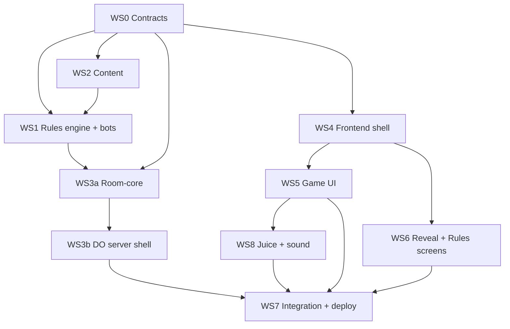

# 06 - Workstreams, Testing, Milestones

Audience: AI coding agents starting a workstream (WS) with no other context. Read: this file, `05-tech-stack.md`, and the docs listed per WS. Facts used everywhere: players 3-6; bays 3 (3-4 players) / 4 (5-6); 12 bid cards per player ($10-300 plus 2 Proxy); 60 items in 6 categories (`toys, media, glass, collectibles, antiques, misc`) plus 9 specials (5 Display Case, 4 Gift); modes Classic and Frenzy; rules IDs R1.. in `01-game-rules.md`; tunable constants in `packages/engine/config.ts`.

## 1. Dependency graph

Soft edges: WS1 and WS3a start against WS0's stub engine/interfaces and swap in the real engine when merged; WS2 and WS1 share the `content` schema defined in WS0, so they run in parallel (WS1 uses a small fixture deck until WS2 lands). WS4/5/6/8 run against `tools/mock-server` and never need the real server.

## 2. Parallelization guide

| Phase | Run simultaneously | Agents |
|---|---|---|
| 1 | WS0 alone (one agent, finish and merge before anything else) | 1 |
| 2 | WS1, WS2, WS3a, WS4 | 4 |
| 3 | WS3b (after WS3a interfaces are stable; can start once WS3a's `reduce/view` signatures are merged, using stub engine), WS5, WS6 | up to 3 more (peak ~5-6) |
| 4 | WS8 (after WS5 exposes feedback hooks) | 1 |
| 5 | WS7 alone | 1 |

Max concurrency: 2 agents at a time on the Pro plan (see README "Working within usage limits"); "parallel" below means no file conflicts, not run-all-at-once. No two parallel WS own the same path (tables below). Shared files (root `package.json`, lockfile, CI config) are touched only by WS0 and WS7; any other WS needing a new dependency adds it only in its own package's `package.json` and mentions it in the PR (lockfile conflicts resolved by rebasing and `pnpm install`).

## 3. Conventions

- **Branches:** one branch per WS: `ws0-contracts`, `ws1-engine`, `ws2-content`, `ws3a-room-core`, `ws3b-server`, `ws4-web-shell`, `ws5-game-ui`, `ws6-reveal-rules`, `ws8-juice`, `ws7-integration`. Sub-branches `ws1-engine/scoring` allowed. Contract changes: `contract/<short-name>`.
- **PRs:** one PR per WS (or per milestone slice), title `WS1: 
`; body lists acceptance criteria with checkboxes, tests run, and any contract/doc changes. Squash-merge. Rebase on main before opening.
- **Commits:** conventional style `ws1: add scoring`. Never commit secrets. Agents commit/push only when told.
- **Ownership:** touch only owned paths. Need something elsewhere? Open a note in the PR / ask the owner; do not edit.
- **Docs:** if behaviour differs from docs, fix the doc in the same PR (docs 01-04 changes need the rule ID kept stable).

### Contract-change process
Contracts = `packages/protocol/**`, room-core exported interfaces (`reduce`, `view`, `Effect`, `RoomState`), engine public API (`packages/engine/index.ts`), `packages/content` schema, mock-server behaviour, and SPEC blocks in `05-tech-stack.md`.
1. Open a PR from `contract/<name>` containing ONLY the contract change: types/zod, mock-server update, stub updates, doc update (05), and a CHANGELOG line in `packages/protocol/CHANGELOG.md`.
2. Bump `PROTOCOL_VERSION` if wire format changes.
3. Must pass typecheck of ALL packages (not just the changed one) and all MUST tests.
4. Merge it before the dependent feature work; affected WS branches rebase. Additive/optional fields are preferred.
5. Never change a contract inside a feature PR.

### Definition of done (every WS)
- All acceptance criteria checked; typecheck + lint clean in the whole repo.
- Required tests written and passing locally and in CI; no skipped tests without a linked reason.
- No `Date.now`/`Math.random` in pure packages; no web import of engine/room-core (lint enforces).
- Docs updated for any deviation; README of the package written (what it exports, how to test).
- PR opened and CI green. No TODO without an owner/issue.

## 4. Workstreams

### WS0 - Contracts
- **Goal:** monorepo skeleton and every cross-WS contract, so others start in parallel.
- **Owns:** repo root files (`package.json`, `pnpm-workspace.yaml`, `tsconfig.base.json`, eslint/prettier configs, `.nvmrc`, `.github/workflows/ci.yml`, `.env.example`, root `README.md`), all `package.json`/`tsconfig` of packages, `packages/protocol/**`, stubs: `packages/engine/` (interfaces + stub engine + `config.ts` skeleton), `packages/room-core/` (interfaces + stub), `packages/content/` (schema + 3-item fixture + `public` entry), `tools/mock-server/**`, `apps/web` and `apps/server` bare scaffolds (after WS0 merges, `apps/web` belongs to WS4/5/6/8 and `apps/server` to WS3b).
- **Inputs:** `05-tech-stack.md`, `01-game-rules.md` (state vocabulary), `03-content.md` (schema).
- **Deliverables:** workspace installs on Windows and Linux; pinned versions table in README; protocol types + zod schemas for every message in 05 section 6; PlayerView type; error codes; room-core interfaces; engine interface + stub; content schema (full + public projection); lint rules (import boundaries, no Date.now/Math.random in pure packages); CI workflow (typecheck, lint, test); mock server speaking the protocol with a scripted fake game (lobby -> Classic and Frenzy play with bay stacks and timers -> gift step -> reveal -> ended -> rematch) incl. reconnect and a bot seat; env var documentation.
- **Acceptance:** `pnpm install && pnpm -r typecheck && pnpm -r lint && pnpm -r test` pass on clean checkout; importing `@auction/engine` from `apps/web` fails lint; zod round-trip tests for every message pass; `pnpm mock` serves a WS where a browser tab can complete join -> snapshot; versions are exact (no `^`); README lists them.
- **Tests:** protocol schema tests (valid + invalid fixtures per message); lint-boundary test (a fixture violating import rules must fail ESLint).
- **Read:** 05, 01, 03, this file.
- **Kickoff prompt:**
  > You are WS0 (Contracts) for the auction game repo. Read docs/05-tech-stack.md and docs/06-workstreams.md section WS0 first. Create the pnpm monorepo, pin exact dependency versions and record them in README, implement packages/protocol (types + zod) exactly per the SPEC blocks in 05, stub interfaces for engine/room-core/content, import-boundary lint rules, CI workflow, and tools/mock-server. Do not implement game rules. Branch ws0-contracts; finish all acceptance criteria before others start.

### WS1 - Rules engine + bots
- **Goal:** pure, seeded, deterministic implementation of `01-game-rules.md` and `02-modes-and-scaling.md`, plus bots and balance simulator.
- **Owns:** `packages/engine/**` (except interface files changed only via contract PR), `tools/sim/**`.
- **Inputs:** WS0; `01`, `02`, `03` (needs content schema; use fixture deck until WS2 lands).
- **Bots are in scope (SHOULD, needed for M2):** random, greedy, careful policies using public info only; same API used by room-core for bot seats.
- **Deliverables:** `createGame(config, seed, players)`, `applyAction(state, action, now)`, `tick(state, now)`, scoring (collections of 3+ double their category; Display Case wild +$100; Gift end-resolution; tie-break by highest unspent bid cards), seeded RNG (e.g. mulberry32/PRNG in-package), deck/bay setup per R1-R6 and the 01 section 8 table (3 or 4 bays), color-call order (Classic), Frenzy rules F1-F8 (timers, anti-snipe, cooldown, last round), reveal->ended deadline (R37), bots (simple heuristic, decide via public info only), `config.ts` with all ASSUMED constants, simulator CLI producing win-rate/score stats and asserting every game terminates.
- **Acceptance:** every rule ID R1.. and F1..F8 has at least one test referencing it by ID in the test name; same seed + same actions -> identical state; illegal actions return an error and leave state unchanged; simulator runs 1000 games per player count 3..6 for both applicable modes with 0 non-terminating games; no I/O or time/random globals.
- **Tests:** engine unit tests (MUST); replay golden test (MUST); ~5 fast-check properties: never throws, cards conserved (every bid card is in a hand or on a bay or discarded as a winner), same seed same result, illegal moves no-op, game always terminates (SHOULD); bot-vs-bot smoke.
- **Read:** 01, 02, 03, 05 section 7.
- **Kickoff prompt:**
  > You are WS1 (Rules engine) for the auction game. Read docs/01-game-rules.md, 02-modes-and-scaling.md, 05-tech-stack.md sections 4 and 7, and 06-workstreams.md WS1. Implement packages/engine as pure deterministic TypeScript (seeded RNG, time passed in, constants only in config.ts), cover every rule ID with a test, add bots and tools/sim. Do not touch other packages; request contract changes via the process in 06. Branch ws1-engine.

### WS2 - Content
- **Goal:** the 60 items and 9 specials as validated data.
- **Owns:** `packages/content/**` (data files, zod validation tests, public projection build).
- **Inputs:** WS0 schema; `03-content.md`.
- **Deliverables:** item data (id, name, category, estimate, actual, icon key/emoji or art id), specials, `public` entry omitting `actual`; validator script.
- **Acceptance:** exactly 60 items, 10 per category (or the distribution in 03), ids unique; 5 Display Case + 4 Gift specials; every item has estimate and actual; public entry exports no `actual` key (test); values within bounds from 03; names fictional, no brand names.
- **Tests:** zod schema validation test (MUST); counts test; public projection no-leak test (MUST).
- **Read:** 03, 05 sections 4 and 10.
- **Kickoff prompt:**
  > You are WS2 (Content). Read docs/03-content.md and 06-workstreams.md WS2. Implement packages/content data per the WS0 schema: 60 fictional items across the six categories, 9 specials, plus a public entry that omits actual values. Add validation and no-leak tests. Branch ws2-content. Edit only packages/content.

### WS3a - Room-core
- **Goal:** pure reducer, view/redaction, lifecycle, host migration, rate-limit logic.
- **Owns:** `packages/room-core/**`.
- **Inputs:** WS0 interfaces; WS1 engine (stub until merged); `05` sections 5-12.
- **Deliverables:** `reduce`, `view` (all fields of 05 section 6.3, nothing more), effects, bot-seat driving via the engine bot policy on `tick` (05 section 8), reveal->ended deadline (01 R37), deadline queue, expiry rules, host migration, auto-pass for disconnected, seq idempotency, per-connection rate-limit counter (pure, time passed in), secret hashing helper interface (hash computed by wrapper; reducer compares hashes), ban list.
- **Acceptance:** all lifecycle transitions in 05 section 8 covered; view never contains forbidden data in any phase for any player; same event log replays to same state; late/invalid/oversized/unknown messages rejected with correct codes and no state change; deadlines drive `tick`; no Date.now.
- **Tests (MUST):** bids, anti-snipe, auto-pass, reconnect, reject late/invalid, **redaction leak test**, replay golden; (SHOULD) fast-check: reducer never throws on arbitrary event sequences.
- **Read:** 05, 01, 02.
- **Kickoff prompt:**
  > You are WS3a (Room-core). Read docs/05-tech-stack.md (sections 4-12) and 06-workstreams.md WS3a. Implement packages/room-core: pure reduce(state,event,now)->{state,effects} and view(state,playerId) as the only redaction path, with lifecycle, host migration, expiry deadlines and idempotent seq handling. Write the redaction leak test across all phases and players. Do not import Cloudflare APIs. Branch ws3a-room-core.

### WS3b - Durable Object server shell
- **Goal:** run room-core inside a PartyServer DO on Cloudflare with storage, alarms, origin checks.
- **Owns:** `apps/server/**`, `.github/workflows/deploy.yml` is WS7's (do not create).
- **Inputs:** WS3a interfaces (stub OK); **complete Open Verifications in 05 section 17 first and append results to `research/tech-decisions.md`**.
- **Deliverables:** Worker entry (`POST /api/rooms`, WS upgrade routing, Origin check, CORS, rate limits), Room class (hello/join handling, zod parse, wrapper order reduce->persist->setAlarm->send, load in `blockConcurrencyWhile`, alarms, hibernation, auto-response keepalive, deleteAll on expiry), `wrangler.jsonc` with `new_sqlite_classes` and envs (`dev`, `preview`, `production`), structured JSON logging, `.dev.vars.example`.
- **Acceptance:** `wrangler dev` on Windows serves create + join + play against the real room-core; alarm fires after the DO is reloaded; bad secret rejected; bad Origin rejected (HTTP and WS); messages >2KB rejected; unknown code 404; expiry deletes storage.
- **Tests (MUST, ~6 with vitest-pool-workers):** join; bid; alarm after reload (`runDurableObjectAlarm`); reconnect; bad secret; origin rejection.
- **Read:** 05 (all), `research/tech-decisions.md`.
- **Kickoff prompt:**
  > You are WS3b (DO server shell). Read docs/05-tech-stack.md fully and 06-workstreams.md WS3b. First do the Open Verifications (section 17) against current PartyServer and vitest-pool-workers docs and record findings in docs/research/tech-decisions.md. Then implement apps/server: Worker + Room DO wrapper around room-core with the exact reduce->persist->setAlarm->send order, hibernation, alarms, origin checks, wrangler config, and the six integration tests. Branch ws3b-server; own only apps/server.

### WS4 - Frontend shell
- **Goal:** Next.js app shell, networking client, landing/join/lobby.
- **Owns:** `apps/web/app/**` EXCEPT `apps/web/app/rules/**` (WS6) and `apps/web/app/r/[code]/game/**` (WS5) (routes: `/`, `/r/[code]` shell, lobby), `apps/web/lib/net/**` (WebSocket client, clock sync, reconnect, store), `apps/web/lib/identity/**`, `apps/web/components/shell/**` (incl. `BottomSheet`/`Sidebar`), `apps/web/components/lobby/**`, `apps/web/styles/tokens.css`.
- **Inputs:** WS0 protocol + mock server; `04-ux-and-ui.md`.
- **Deliverables:** typed `useRoom()` hook exposing latest `PlayerView`, send helpers with `seq`/ack tracking, clock-offset estimator, reconnect with backoff, visibility/Wake Lock handling, secret storage in localStorage per code, landing (create/join/rules link), join page (name, audio unlock hook point), lobby (code, copy link, chips, rename, host controls: start/kick/add-remove bot/mode/bid window/relaxed via `setOpts`), layout slots for game screen (status strip placeholder, route to `GameScreen` component owned by WS5), design tokens (player colors, shapes).
- **Acceptance:** against mock server: create -> lobby -> join from second tab -> start; refresh restores seat; killing the mock and restarting reconnects with backoff; rev ordering ignores stale snapshots (unit test); no imports of engine/room-core; tap targets >= 44px; works at 390px width.
- **Tests:** unit tests for clock-offset median, rev gating, reconnect backoff (MUST for net logic); Playwright smoke vs mock (SHOULD).
- **Read:** 04, 05 sections 5, 6, 11, 14.
- **Kickoff prompt:**
  > You are WS4 (Frontend shell). Read docs/04-ux-and-ui.md, docs/05-tech-stack.md sections 5, 6, 11 and 06-workstreams.md WS4. Build in apps/web: the networking client (useRoom, seq/acks, clock sync, reconnect, rev gating), landing, join and lobby screens, and design tokens, developing against tools/mock-server. Only import @auction/protocol and @auction/content/public. Own only the paths listed for WS4. Branch ws4-web-shell.

### WS5 - Game UI
- **Goal:** the playable game screen per 04 (mobile 390x844 without scrolling; desktop layout).
- **Owns:** `apps/web/components/game/**`, `apps/web/app/r/[code]/game/**` (or the slot WS4 defines), `apps/web/lib/game-ui/**` (selection state, legal-bay computation from view).
- **Inputs:** WS4 `useRoom`; protocol; `04`; mock server.
- **Deliverables:** status strip (44px) + event-log sheet hook, turn banner/timer bar, bays (3 stacked, 4 as 2x2), my collection strip, hand grid (12 bid cards only; won specials show in the collection strip), `MoreSheet`/`EventLog`, two-tap bidding with legal-bay glow/dim, rejection shake, desktop layout with the keyboard shortcuts in 04 section 6, Classic/Frenzy variants, per-element `data-fx` attributes and `data-state` hooks that WS8 uses, ARIA live region on status strip, colorblind-safe color+shape+name.
- **Acceptance:** layout fits the 04 budget (~696/~640 px) at 390x844 for 3 and 4 bays (verified by a Playwright viewport measurement or manual screenshot); nothing needed to play is behind a tap; bidding in two taps; illegal bays dimmed; keyboard flow works; states not colour-only; reduced motion respected.
- **Tests:** unit tests for legal-bay logic and selection state (MUST for logic); component render tests optional; Playwright 1-browser smoke vs mock (SHOULD).
- **Read:** 04, 02, 05 section 6.3.
- **Kickoff prompt:**
  > You are WS5 (Game UI). Read docs/04-ux-and-ui.md, docs/02-modes-and-scaling.md, 05 section 6.3 and 06-workstreams.md WS5. Implement the game screen in apps/web/components/game against useRoom and the mock server: status strip, bays, hand, collection strip, two-tap bidding, desktop layout. Match the pixel budget in 04; expose data-fx / data-state hooks for WS8 and do not add animations beyond basic CSS states. Branch ws5-game-ui; own only WS5 paths.

### WS6 - Reveal + Rules screens
- **Goal:** results and rules pages.
- **Owns:** `apps/web/components/reveal/**`, `apps/web/components/gift/**` (`GiftStep`, mounted by the WS5 game route), `apps/web/components/rules/**`, `apps/web/app/rules/**`, `apps/web/lib/reveal/**`.
- **Inputs:** WS4; protocol `reveal` view section; `01`, `04`.
- **Deliverables:** reveal sequence (values flip per category, STEAL!/Ripped off! tags, collection doubling shown), ranked scoreboard, host rematch/leave, gift step UI per 04 section 3.5b (**WS6 owns gift UI**; WS5 only mounts it), rules page and rules sheet rendering text derived from `01` (copy kept in `apps/web/components/rules/content.ts`).
- **Acceptance:** every rule in 01 summarized, with rule IDs in source comments; reveal works with mock-server reveal data; sorted scoreboard handles ties per R35; works without sound/motion (static fallback when reduced motion); no actual values requested before `phase` is reveal/ended.
- **Tests:** scoreboard ordering unit tests (MUST for logic); Playwright smoke (SHOULD).
- **Read:** 01, 04, 05 section 6.3.
- **Kickoff prompt:**
  > You are WS6 (Reveal and Rules). Read docs/01-game-rules.md, docs/04-ux-and-ui.md and 06-workstreams.md WS6. Build the reveal/results screen, gift resolution UI, scoreboard, rematch/leave, and the rules page+sheet in apps/web under reveal/ and rules/ paths only, using the mock server's reveal data. Reduced-motion and sound-off must work fully. Branch ws6-reveal-rules.

### WS8 - Juice and sound
- **Goal:** the six feedback moments and optional sound, never blocking gameplay.
- **Owns:** `apps/web/lib/fx/**` (snapshot-diff -> feedback events, Web Audio player, haptics, confetti loader), `apps/web/components/fx/**`, `apps/web/styles/fx.css`, `apps/web/public/audio/**`.
- **Inputs:** WS5 data hooks (`data-fx`, `data-state`); `04`; research/tech-decisions.
- **Deliverables:** feedback event derivation by diffing consecutive snapshots (bid bump, your turn, outbid, timer red + "+3s", SOLD, reveal); CSS keyframes for the CSS ones; Motion (14.1.0 pinned, LazyMotion + `m` + `domMax`, `MotionConfig reducedMotion="user"`) for SOLD stamp and reveal flip; canvas-confetti lazy-loaded; ~100-line Web Audio player unlocked on Join tap (sound off by default); Sound/Haptics toggles as a `SoundHapticsToggles` component in `components/fx/**` that WS5's `MoreSheet` Settings tab mounts (Relaxed is a host option, WS4/WS5); Android vibrate only.
- **Acceptance:** with sound off and reduced motion on, the game is fully playable and information-identical; no new permanent UI elements; sound off by default and persisted; audio unlock works on iOS Safari (manual check); bundle impact: Motion lazy ~20kb, confetti loaded only at reveal; no layout shift from effects (feedback uses existing elements).
- **Tests:** unit tests for snapshot-diff event derivation (MUST for logic); manual iPhone check; no visual regression (SKIP).
- **Read:** 04, `research/tech-decisions.md` (libraries, sound-off rationale).
- **Kickoff prompt:**
  > You are WS8 (Juice and sound). Read docs/04-ux-and-ui.md (six feedback moments, sound-off), research/tech-decisions.md libraries section, and 06 WS8. In apps/web/lib/fx and components/fx implement snapshot-diff feedback events, the CSS/Motion effects, lazy confetti and a tiny Web Audio player; attach effects only to existing elements via WS5's data-fx hooks. Everything must be optional and respect reduced motion. Branch ws8-juice.

### WS7 - Integration and deploy
- **Goal:** wire real server, deploy, smoke, playtest.
- **Owns:** `.github/workflows/deploy.yml`, `tools/smoke/**`, `tools/e2e/**` (Playwright), root deploy docs section in README, Vercel project settings notes (`docs/07-playtest-log.md` may be created).
- **Inputs:** all other WS merged.
- **Deliverables:** CD workflow (wrangler deploy with `CLOUDFLARE_API_TOKEN` then smoke), smoke script (create room, join over WS, assert snapshot), Playwright 1-3 browser + bots game to completion, preview env wiring, real-device iPhone-over-LAN checklist, playtest session notes, bug list.
- **Acceptance:** push to main deploys Worker and smoke passes; Vercel production + preview talk to the right Worker env; full bots game completes online; checklist run on a real iPhone; docs README status updated.
- **Tests:** Playwright e2e vs deployed preview (SHOULD); smoke (MUST in CD).
- **Read:** 05 sections 13-16, this file section 5.
- **Kickoff prompt:**
  > You are WS7 (Integration and deploy). Read docs/05-tech-stack.md sections 13-16 and 06-workstreams.md WS7. Replace the mock server with the real Worker, add the deploy workflow and smoke script, add a Playwright bots-game e2e, and prepare the real-device playtest checklist. Do not deploy during an active playtest. Branch ws7-integration.

## 5. Testing strategy

| Tier | Item | Class | Effort |
|---|---|---|---|
| Static | Typecheck + lint (incl. import boundaries, no Date.now/Math.random in pure packages) | MUST | ~0.5 d (in WS0) |
| Unit | Engine rules tests, each R-id covered | MUST | with WS1 |
| Schema | zod protocol + content schemas, public-projection no-leak | MUST | with WS0/WS2 |
| Replay | Logged seed + events reproduce golden snapshots | MUST | ~0.25 d |
| Room-core | bids, anti-snipe, auto-pass, reconnect, reject late/invalid, **redaction leak test** | MUST | with WS3a |
| DO integration | ~6 tests, `@cloudflare/vitest-pool-workers`: join, bid, alarm after reload, reconnect, bad secret, origin reject | MUST | ~0.5 d |
| Client logic | clock offset, rev gating, reconnect backoff, legal-bay, diff->fx events, scoreboard | MUST | with WS4-8 |
| Property | ~5 fast-check props (never throws, cards conserved, deterministic, illegal no-op, terminates) | SHOULD | ~0.25 d |
| Simulator | Balance sim on content change; CI asserts every game ends | SHOULD | with WS1 |
| Bots | power sim, "Add bot", e2e | SHOULD | with WS1 |
| E2E | Playwright smoke 1-3 browsers + bots, run off main | SHOULD | ~0.5 d |
| Manual | Real iPhone over LAN before each playtest | SHOULD | 15 min each |
| Skip | Full 6-browser Playwright, visual regression, Storybook | SKIP | - |

CI target about 3 minutes on the GitHub free tier; MUST tests block merge. Overall effort: about 2 days up front, then about 20% extra per feature.

## 6. Milestones

| Milestone | Definition | WS | Exit check |
|---|---|---|---|
| **M1 Contracts** | Repo, protocol, stubs, mock server, CI green | WS0 | Fresh clone passes install/typecheck/lint/test; mock serves a fake game |
| **M2 Playable local game vs bots** | Real engine + room-core + UI run locally against bots (via mock/real local server) from landing to results | WS1, WS2, WS3a, WS4, WS5, WS6 (+WS3b optional) | One person plays a full game vs bots on desktop and phone viewport; sim passes |
| **M3 Online multiplayer deployed** | Worker on Cloudflare, web on Vercel, rooms, reconnect, expiry; smoke passes | WS3b, WS7 | 3 humans on 3 devices finish a game; reconnect mid-game works |
| **M4 Juice and polish** | Six feedback moments, sound, a11y pass, relaxed timing | WS8 | Fully playable sound-off/reduced-motion; checklist signed off |
| **M5 Playtest** | Real group playtest on real devices; notes and balance changes | WS7 | Session log; constants retuned in `config.ts`; Later-list triaged |

## 7. Notes for agents running in parallel
- Pull main and rebase daily; keep PRs small.
- If blocked by a missing contract, open a contract PR rather than inventing local types.
- Test with fixtures, not with the real network, unless your WS is WS3b/WS7.
- When docs disagree, order of authority: code in `protocol` (after WS0) > 05 > 01 > 02 > 04 > 03 > research.
